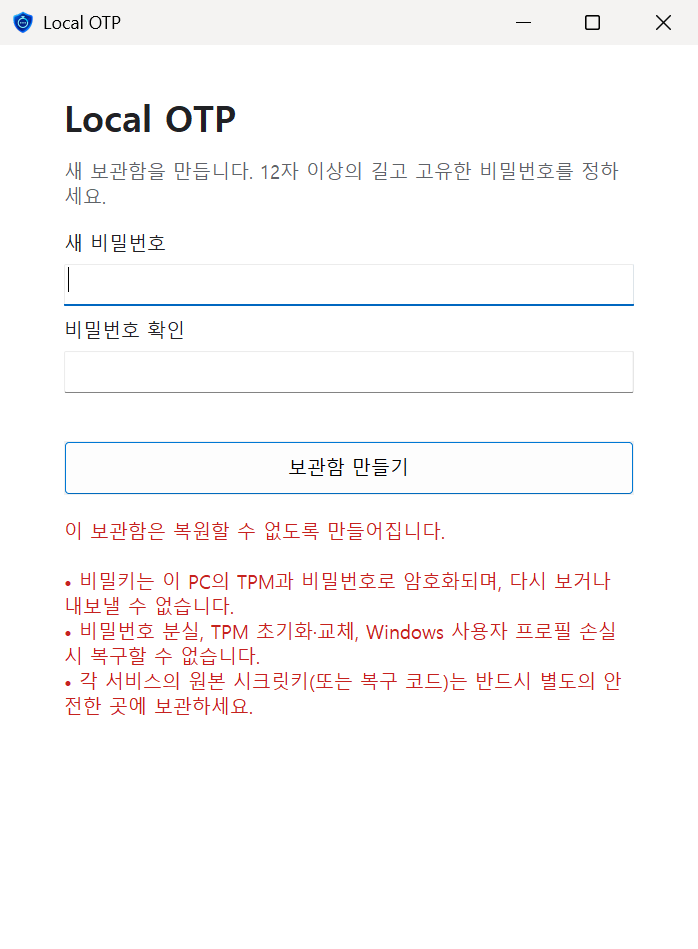
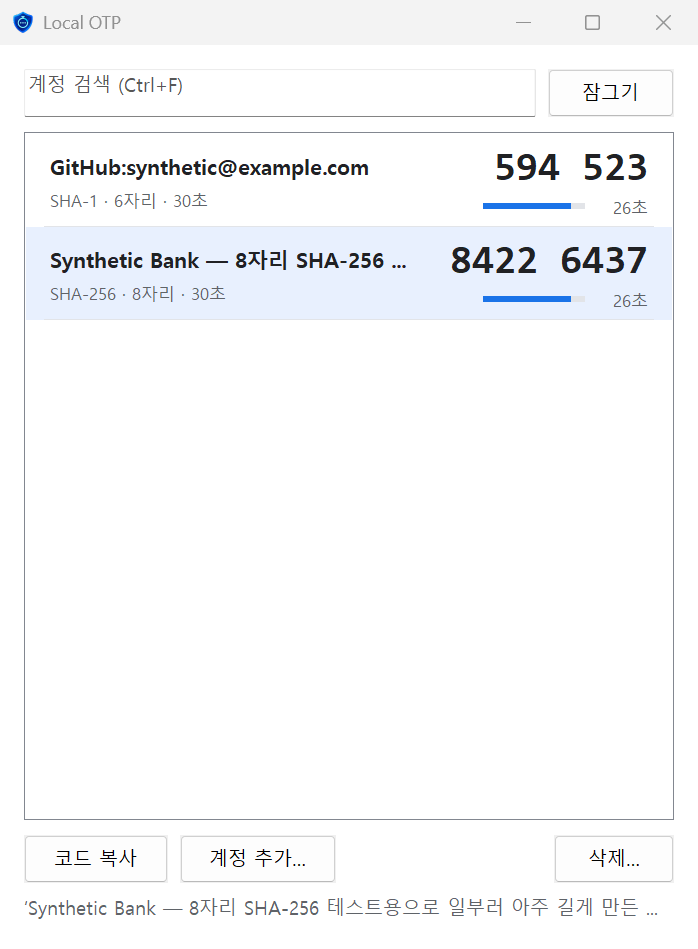
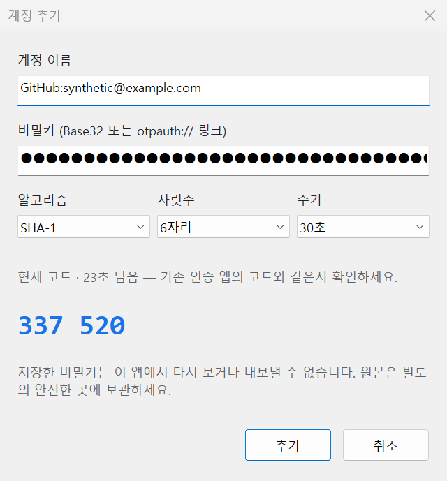

# Local OTP

**하드웨어에 묶여 비밀키를 다시 꺼낼 수 없는, 오프라인 TOTP 인증 앱 — Windows · Android**

| 앱 | 위치 | 보호 |
| --- | --- | --- |
| Windows | 이 문서 (저장소 최상위) | TPM + 비밀번호 |
| Android | [`android/`](android/README.md) | Android Keystore(StrongBox/TEE) + 생체인증/화면 잠금 + 비밀번호 |

아래는 **Windows 앱** 설명입니다.

> 📱 **Android 버전**은 [`android/`](android/README.md)에 있습니다. 같은 설계(복원 불가능, 하드웨어 키 + 비밀번호, 네트워크 권한 없음)를 Android Keystore(StrongBox/TEE)와 생체인증으로 구현했습니다. 두 앱은 서로 데이터를 주고받지 않으며, 각 기기에서 원본 시크릿키로 따로 등록합니다.

> An offline TOTP authenticator for Windows 11. Secrets are sealed with a non-exportable TPM key plus your password, and can never be displayed or exported again — not even by this app. Keep your original secrets somewhere else; this app only generates codes. Rust, zero third-party crates, Windows CNG only.

<p align="center">
  
  
  
</p>
<p align="center"><sub>화면의 계정과 코드는 모두 테스트용 가짜 데이터입니다.</sub></p>

## 한눈에 보기

- **복원 불가능(non-recoverable) 설계** — 한 번 등록한 비밀키는 화면에 다시 표시되지 않고, 내보내기·백업·동기화 기능이 없습니다. 보관함 파일을 다른 PC로 복사해도 열리지 않습니다.
- **TPM + 비밀번호 이중 보호** — 보관함 키는 `PBKDF2(비밀번호)` ⊕ `TPM으로만 풀리는 난수`입니다. 둘 중 하나만으로는 열 수 없습니다.
- **완전 오프라인** — 네트워크 코드가 없습니다. 외부 Rust 패키지 0개, 암호 연산은 모두 Windows CNG/TPM이 수행합니다.
- **SHA-1/SHA-256/SHA-512, 6/8자리, 30/60초** TOTP 지원. Base32 키나 `otpauth://` 링크로 등록합니다.

## 누구에게 맞나

**맞는 경우**

- 2FA 비밀키를 **클라우드·휴대폰 백업·동기화에 절대 올리고 싶지 않은** 사람
- 원본 시크릿키(또는 복구 코드)를 **종이, 오프라인 금고, 하드웨어 보안 장치 등 별도의 안전한 곳에 이미 보관**하고, PC에서는 "코드 생성기"만 필요한 사람
- 휴대폰 분실·도난이 2FA 탈취로 이어지는 것을 피하고 싶은 사람
- 특정 PC 한 대에서만 OTP가 나오도록 **기기에 묶어 두고 싶은** 사람(업무용 PC, 개인 데스크톱 등)
- 앱이 클라우드 클립보드나 화면 공유로 코드를 흘리지 않기를 원하는 사람

**맞지 않는 경우**

- 원본 시크릿키를 따로 보관하지 않은 사람 — **이 앱이 유일한 사본이면 PC 고장·TPM 초기화 한 번에 계정을 잃습니다.**
- 여러 기기 동기화, 휴대폰 연동, 백업/복원이 필요한 사람
- 같은 Windows 계정에서 악성코드가 돌 수 있는 환경을 막아야 하는 사람(아래 "보호하지 못하는 것" 참고)
- TPM 2.0이 없거나 꺼져 있는 PC

## 무엇이 안전한가

| 상황 | 결과 |
| --- | --- |
| `vault.bin` 파일이 유출되거나 다른 PC로 복사됨 | 열 수 없음. 이 PC의 TPM 키가 필요하고, TPM 키는 내보낼 수 없음 |
| 같은 PC의 **다른 일반 Windows 사용자**가 파일을 읽음 | 열 수 없음. TPM 키는 원래 사용자 프로필에 저장되어 다른 사용자가 쓸 수 없음(이 PC의 **관리자**는 예외일 수 있음) |
| 비밀번호만 유출됨 | 다른 PC에서는 무용지물. 이 PC + 이 사용자 + 비밀번호가 모두 필요 |
| 보관함 파일이 변조·손상됨 | AES-256-GCM 인증으로 검출하고 열기를 거부. 손상된 파일 위에 덮어쓰지 않음 |
| 앱을 열어 둔 채 자리를 비움 | 5분 무입력, Windows 잠금·로그오프·원격 연결 끊김·절전 시 즉시 잠기고 메모리의 키를 지움 |
| 화면 녹화·화면 공유·스크린샷 | 앱 창이 캡처에서 제외됨 |
| 복사한 코드 | Windows 클립보드 기록·클라우드 클립보드 제외 표시, 30초 후 또는 잠글 때 자동 삭제 |
| 누군가 잠금 해제된 PC에서 계정을 지우려 함 | 삭제는 보관함 비밀번호를 다시 입력해야 함 |

## 반드시 알아야 할 주의사항

1. **이 앱은 백업이 아닙니다.** 다음 중 하나라도 일어나면 보관함은 영구히 열 수 없습니다: 비밀번호 분실, TPM 초기화·교체(BIOS에서 TPM 지우기, 메인보드 교체 등), Windows 재설치·사용자 프로필 삭제, 파일 손상. **각 서비스의 원본 시크릿키나 복구 코드를 반드시 별도의 안전한 곳에 보관하세요.**
2. **같은 Windows 계정의 악성코드는 막지 못합니다.** 코드를 만들려면 비밀키가 실행 중인 프로세스의 메모리에 있어야 합니다. 같은 사용자 권한이나 관리자 권한으로 도는 악성코드는 메모리를 읽거나 TPM 키를 사용할 수 있습니다.
3. **비밀번호는 TPM PIN이 아닙니다.** TPM의 하드웨어 추측 횟수 제한은 적용되지 않습니다. 이 PC의 사용자 권한을 얻은 공격자는 PBKDF2(600,000회)를 상대로 비밀번호 추측을 시도할 수 있으니 **길고 고유한 비밀번호**를 쓰세요.
4. **되돌리기(rollback) 공격은 막지 못합니다.** 과거에 정상 저장된 보관함 파일로 바꿔치기하는 것은 자체적으로 검출하지 않습니다.
5. 비밀키를 입력하는 과정에서 거치는 키보드, 클립보드, 입력기, QR 디코더 같은 다른 소프트웨어의 보안은 이 앱이 책임질 수 없습니다. 앱이 지운 버퍼 외에 OS 컨트롤, 페이징 파일, 크래시 덤프에 남은 사본까지 완전히 지워진다고 보장할 수 없습니다.
6. 화면 캡처 제외 때문에 원격 데스크톱·화면 공유에서는 앱 창이 검게 보일 수 있습니다.
7. 등록 후에는 알고리즘·자릿수·주기를 바꿀 수 없습니다. 잘못 등록했다면 삭제 후 다시 등록하세요.
8. **외부 보안 감사를 받지 않은 개인 프로젝트입니다.** 실사용 전에 가짜 데이터로 먼저 동작을 확인하고, 기존 인증 앱을 바로 지우지 말고 한동안 함께 쓰며 코드가 같은지 검증하세요.

## 사용법

1. `local-otp.exe`를 실행합니다.
2. 처음에는 새 보관함을 만듭니다. 12자 이상의 비밀번호를 두 번 입력하고, 복구 불가능 경고를 확인하면 생성됩니다.
3. **계정 추가…**에서 이름과 비밀키(Base32 또는 `otpauth://totp/...` 링크)를 입력합니다. 링크를 넣으면 이름·알고리즘·자릿수·주기가 자동으로 채워집니다.
4. 대화상자의 **미리보기 코드**가 기존 인증 앱과 같은지 확인한 후 추가합니다.
5. 목록에서 더블클릭, Enter, **코드 복사**로 코드를 복사합니다.

| 단축키 | 동작 |
| --- | --- |
| Ctrl+F | 계정 검색 |
| Ctrl+N | 계정 추가 |
| Ctrl+C / Enter / 더블클릭 | 선택한 코드 복사 |
| Delete | 선택한 계정 삭제(비밀번호 확인) |
| Ctrl+L | 잠그기 |
| Esc | 검색어 지우기 |

보관함은 `%LOCALAPPDATA%\LocalOtp\vault.bin`에 저장됩니다.

## 요구 사항

- Windows 10/11 x64, **TPM 2.0 활성화**(Windows 11 기본 요건). 하드웨어 TPM 공급자를 쓸 수 없으면 소프트웨어 키로 대신하지 않고 오류를 냅니다.
- 빌드: Rust(MSVC 툴체인)와 Windows SDK

```powershell
cargo build --release
# 결과: target\release\local-otp.exe
```

미리 빌드한 실행 파일은 배포하지 않습니다. 보안 도구이므로 소스를 확인하고 직접 빌드해 쓰는 것을 권장합니다.

## 암호 설계 요약

```
비밀번호 ──PBKDF2-HMAC-SHA256(600,000회, 32바이트 솔트)──► P
TPM 난수 S (저장할 때마다 새로 생성) ──RSA-2048-OAEP(TPM, 내보내기 불가 키)──► 래핑된 S
보관함 키 = P ⊕ S
내용 = AES-256-GCM(보관함 키, 96비트 난수 nonce, 헤더 전체를 AAD로 인증)
```

- TPM 키는 Microsoft Platform Crypto Provider에 사용자 단위로 만들어지며, 열 때마다 하드웨어 공급자·내보내기 금지·RSA-2048·복호화 용도인지 검사합니다.
- 보관함을 여는 동안은 비밀번호 원문 대신 `P`만 메모리에 두고, 잠그면 지웁니다.
- 저장 전에 현재 파일이 이 세션이 연 파일과 바이트 단위로 같은지, 같은 키로 복호화되는지 확인하고, **새로 암호화한 결과도 TPM으로 다시 열어 내용이 같은지 검증한 뒤에만** 임시 파일 + 원자적 교체로 씁니다.
- 비밀번호·비밀키를 읽는 버퍼는 재할당 없이 한 번에 잡고 사용 후 지우며, AES 키 스케줄 메모리도 앱이 직접 할당해 지웁니다.

자세한 내용은 [SECURITY.md](SECURITY.md)를 참고하세요.

## 테스트

```powershell
cargo test                                   # 실제 데이터나 TPM 키에 접근하지 않음
cargo test -- --ignored                      # 하드웨어 TPM 통합 테스트
```

TPM 통합 테스트는 `OtpMigration.WindowsOtp.SyntheticTestKey.<임의값>` 이름의 임시 TPM 키를 만들어 암·복호화, 변조 검출, 개인키 내보내기 거부를 확인한 뒤 그 키를 삭제합니다. 앱이 쓰는 실제 키 이름은 테스트 빌드에 포함되지 않습니다.

화면을 시험할 때는 `LOCALAPPDATA` 환경 변수를 임시 폴더로 바꿔 실행하면 실제 보관함 파일을 건드리지 않습니다. 다만 이 경우에도 앱의 실제 TPM 키(없으면 새로 만듦)를 함께 사용합니다. 키를 수정·삭제하지는 않습니다.

## 라이선스

[Apache License 2.0](LICENSE)
